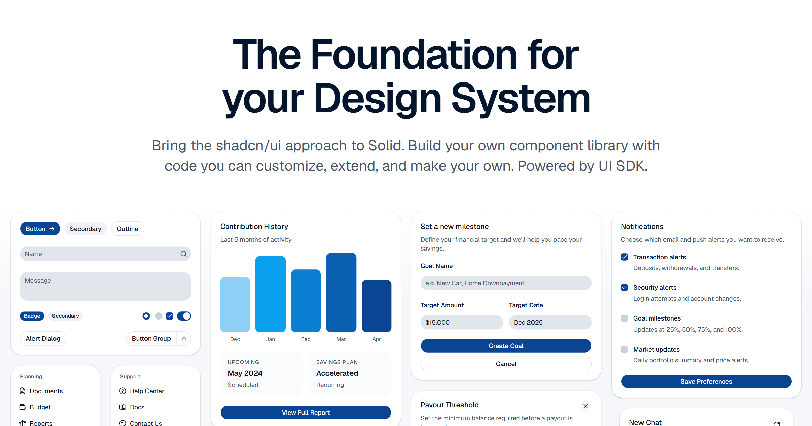

# Solid UI

Accessible and customizable components that you can copy and paste into your apps. Free. Open Source. **Use this to build your own component library**.

An unofficial port of [shadcn/ui](https://github.com/shadcn-ui/ui) to [Solid](https://www.solidjs.com/), built on [UI SDK](https://ui-sdk.dev).

## Documentation

Visit https://www.solid-ui.com to view the documentation.

> [!WARNING]
> Version 2 targets Solid 2 and still depends on beta packages. Version 1 (Solid 1, Kobalte) lives at the [`v1-final`](https://github.com/stefan-karger/solid-ui/tree/v1-final) tag.

## Contributing

Please read the [contributing guide](./CONTRIBUTING.md).

## License

Licensed under the [MIT license](./LICENSE). Built by [@stefan-karger](https://github.com/stefan-karger), [@michaelessiet](https://github.com/michaelessiet) & [community](https://github.com/stefan-karger/solid-ui/graphs/contributors).

